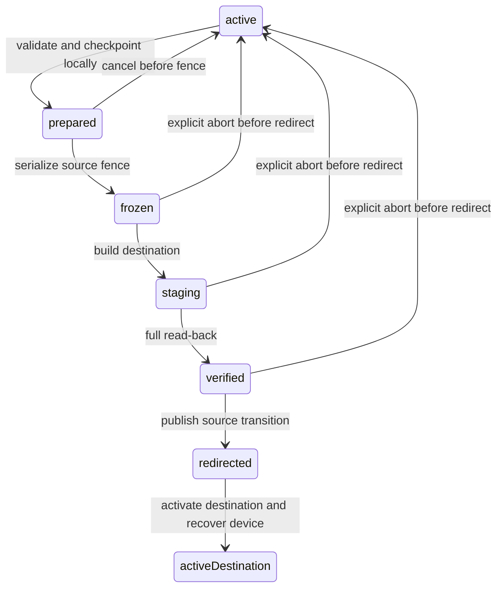

# Sync maintenance and offline recovery — accepted protocol

2026-10-13 · **Accepted by owner; ADR-016. Implementation and verification remain in progress.**

The owner requested this design before implementation and approved its three
choices on 2026-10-13. This protocol is authoritative alongside SYNC.md and
SECURITY.md. Acceptance is not evidence that maintenance or real-forge
concurrency tests work. Runtime availability is recorded in STATUS.md.

## 1. First release policy

Use a **verified migration to a new empty private repository** for history
compaction and data-key rotation on both forges. Keep the source repository
frozen and available for recovery. Switch a device only after a complete
destination read-back. Do not automatically delete the source.

Keep every tombstone, every original text version and every attachment in the
current snapshot. Compact Git history, not record provenance. There is no
180-day deletion deadline or maximum supported offline period in this version.
An unchanged old copy must not resurrect a deleted record.

This supersedes the original SYNC.md §9 sketch. It requires a second private
repository, an upgraded vault header and serialized GitLab writes. It avoids
unsafe forced ref replacement and non-atomic default-branch switching. It uses
only the user's configured forge and the existing libsodium primitives.

Same-repository history replacement and provenance pruning remain future work.
They must not be presented as available maintenance options.

## 2. Why the current maintenance sketch is insufficient

- GitHub's ref update accepts a target SHA and `force`, with no documented
  expected-old-SHA argument. Checking a head, then forcing a ref, leaves a race
  that can overwrite a concurrent write. Ordinary single-parent fast-forward
  commits remain suitable for the normal sync path. See the
  [GitHub refs API](https://docs.github.com/en/rest/git/refs).
- GitLab documents `last_commit_id` for an individual file action. It is not a
  documented whole-branch lease. Maintenance must share a file concurrency gate
  with **every** ordinary write, including create-only batches. See the
  [GitLab commits API](https://docs.gitlab.com/api/commits/). The proposed gate
  still requires a real-forge race test; documentation is not experimental proof.
- Removing a tombstone loses the distinction between a never-uploaded local
  creation and an unchanged stale copy. A time threshold does not recover that
  information.
- Pruning text parents invalidates an offline edit's ancestry. ADR-013 requires
  those original versions to remain available until a separate causal
  checkpoint protocol is accepted.
- Rewrapping a passphrase does not revoke the data key. Anyone who saved an old
  header and knows the old passphrase can still obtain that same key.

These are design conclusions from the documented interfaces and existing data
format, not claims that an authenticated forge spike has been run.

## 3. Safety invariants

1. Local records, dirty entries, merge bases, unknown records and attachments
   survive every failure. Maintenance never starts with a destructive local
   wipe, a replacement DB or cleared change log.
2. One immutable source commit defines the migration snapshot. Every remote
   path in that tree is inventoried; enumeration truncation is an error.
3. The destination contains no user content, IDs, types, device names or keys in
   plaintext. Commit messages remain `sync`, with the specified neutral author
   and committer. Repository names and activity metadata remain accepted leaks.
4. A device never writes using an old key or old generation to the destination.
   A cached branch name is not authority to write.
5. A completed upload is not a completed migration. Read-back, authentication,
   inventory verification and source transition publication must all succeed.
6. A remote absence is not a deletion command. Preserve unmatched local records
   and report an inconsistency before deciding whether to upload them.
7. A successful response lost in transit must be reconciled by reads. Retrying
   cannot create another destination, silently overwrite files or clear newer
   local edits.
8. Maintenance is user initiated. No timer expires a fence, deletes backups,
   retires devices or prunes data.

## 4. Proposed vault version 2 and authenticated write gate

Keep the existing KDF, two wrapped keys, key-check and creation-date fields in
`lm.json`. Change its `version` to `2` and add one encrypted `control` string.
Version 1 readers must reject version 2 for writes; there are currently no
implemented sync clients to migrate. Future unsupported versions always stop
sync without deleting local data.

`control` is ASCII `LMC2.` followed by base64url of a random 24-byte nonce and
XChaCha20-Poly1305 ciphertext. Use the existing record subkey via a new audited
`packages/crypto` wrapper. The AEAD associated data is UTF-8 `lmc2|` plus the
lowercase hex BLAKE2b-256 digest of the header without `control`.

Define the digest input explicitly: a fixed-order JSON tuple containing
`format`, `version`, the KDF tuple `(alg, opslimit, memlimit, salt)`, the wrapped
key tuples `(kind, nonce, ct)` sorted by kind, `keyCheck` and `createdAt`. Encode
with `JSON.stringify` and UTF-8, with no insignificant whitespace. Reject
duplicate key kinds, unexpected header fields and unsupported versions before
computing it. Test that alternate input property order gives the same bytes and
that changing any authenticated field fails. No new cryptographic primitive or
plaintext control metadata is introduced.

The decrypted control object uses a strict zod schema. A migrated active
control retains operation ID, transition and inventory together as a receipt;
a fresh active control has none of these. Staging requires all three, frozen
requires only operation ID, and redirect requires operation ID and transition.
Random identifiers/fingerprints are 64 lowercase hex characters; generation and
byte sizes are safe integers. Transition destination generation equals the
source generation plus one for redirect, or current generation for staging/active.
Inventory entries are unique and lexicographically sorted by opaque path.

The decrypted control fields are:

| Field | Meaning |
|---|---|
| `vaultId` | Random 32-byte identity, unchanged across migration |
| `generation` | Positive safe integer, incremented for every migration |
| `writeNonce` | Fresh random 32 bytes for every successful write attempt |
| `state` | `active`, `frozen`, `staging` or `redirect` |
| `operationId` | Random 32 bytes for maintenance states; retained in an active destination migration receipt |
| `transition` | For staging/redirect: operation kind, source forge identity, source commit, source header digest, destination forge identity, destination generation and public data-key fingerprint |
| `inventory` | Staging/active migrated destination only: encrypted payload manifest and its source snapshot anchor; retained for verification/recovery |

Forge identity includes the configured HTTPS API origin and the forge's stable
repository/project ID, not just a renameable owner/name. Transition information
is encrypted. Tokens, passphrases and keys are never included. A key fingerprint
uses libsodium BLAKE2b with the fixed domain string `lm-key-fingerprint-v2` and
the data key, and is stored only inside encrypted control/local secrets state.
The UI can display a short form solely for deliberate user comparison.

Every sync cycle reads the header at its exact remote head and validates the
control before accepting records or attempting a write. Every write includes
a newly encrypted control with a fresh nonce, even when only creating records.
On GitHub, publish a single-parent commit with `force:false`; re-read and retry
a genuine race. Do not classify every 422 as a race: validation, permissions
and abuse-limit errors must surface distinctly.

On GitLab, update `lm.json` with its last known **file commit ID**, from a read
pinned to that head, in the same atomic action batch as all other changes.
That ID is not necessarily the branch head. If the gate changed, the whole
batch must fail. The P0.2 contract test must prove this for update, delete and
create-only batches, including a maintenance race and a lost response. If the
gate does not provide these semantics, do not enable GitLab maintenance; record
the failed assumption and return to owner review.

A `frozen`, `staging` or `redirect` source permits local edits but rejects
ordinary remote writes. Direct forge edits or legacy/nonconforming clients
are not fenced by encryption alone. Unexpected source changes invalidate the
snapshot and stop migration for recovery; they are never silently discarded.

## 5. State machine and durable checkpoints

States after `prepared` are reconciled with authenticated remote facts, not
inferred from a local progress bar. `activeDestination` uses generation + 1.
The destination stays `staging` until the source is `redirect`. A crash between
redirect and activation leaves the source redirecting to a staging destination;
the resume flow verifies the operation and activates it. Readers may inspect a
staging destination, but ordinary writes remain disabled.

Before fencing, persist an operation checkpoint containing operation ID, source
identity/head, destination identity, expected generation, phase and verified
inventory progress. Keys and credentials go exclusively through
`platform.secrets`. On web, durable new-key recovery must be possible through
the new header/passphrase or recovery key before publishing the fence; a
memory-only key is insufficient for crash recovery.

Before a device changes its configuration, take a transactionally consistent
local recovery snapshot: records including tombstones, raw preservation/problem
rows, dirty `(id, hlc)` pairs, sync bases and attachment inventory. Preserve
encrypted attachment files and their decrypting keys until re-encryption is
verified. Local metadata can live in SQLite; key material cannot. Protect backup
secrets through the platform adapter and apply the existing local-at-rest policy
to the DB. Never upload this plaintext checkpoint.

The source fence remains durable until explicit resume/abort. There is no
timeout takeover. A different device can resume only through a user-visible
recovery flow that proves access to both vaults and reconciles remote state.

## 6. Migration procedure

1. Ask the user to configure a private, empty destination with write access.
   Refuse a nonempty repository, even one containing a superficially matching
   header, unless its authenticated operation ID matches a recorded resume.
   No external repository is created during design review.
2. Finish a normal source sync, then acquire the local sync lock. Other devices
   may keep working locally. Save the durable checkpoint and backup described
   above. Do not assume every device is online.
3. Publish a fenced source header through the ordinary serialized write path.
   A competing writer or maintenance operation loses the race and must re-read.
   The successful fence commit is the immutable snapshot anchor.
4. Inventory its entire tree, including tombstones, retained text graphs,
   attachments, unknown schemas and problem ciphertext. Build a canonical
   encrypted manifest of sorted `(path, byte length, BLAKE2b ciphertext digest)`
   entries. Keep the expected manifest in the local recovery checkpoint too.
   The manifest is part of encrypted control staging data, never a plaintext
   path/count list containing user identifiers. Exclude `lm.json` itself from
   this payload manifest to avoid a self-referential digest.
5. Create the destination header in `staging`. Upload bounded batches with
   normal transport atomic commits; no write contains plaintext. Compare
   existing paths with the checkpoint inventory when resuming. Never blindly
   issue another create or adopt an unrelated existing object.
6. Re-read the destination by an exact head and verify every manifest entry,
   count, path and byte digest. For rotated files, also authenticate/decrypt and
   compare the preserved envelope/blob bytes to the source plaintext. Verify
   that the destination has no extra files. Persist the verified head.
7. Re-read the source. If its head or operation/control state changed beyond
   this operation's allowed transitions, stop and preserve both sides. Otherwise
   publish its `redirect` with the verified destination identity/generation
   using the serialized gate. This is the point after which abort is forbidden.
8. Activate the matching staging destination with a normal gated commit. If the
   response is lost, read it back and verify the operation rather than recreate
   the repository. Resume offline edits using §8 before normal sync.

There is no cross-repository atomic transaction. The persistent source redirect,
destination staging state and operation ID make the interval recoverable.
Do not repoint the old repository's branch or silently delete either repository.

## 7. Compaction, passphrase change and key rotation

**History compaction:** copy the current snapshot ciphertext byte-for-byte into
the destination using the same data key and paths. Preserve corrupt and
unknown-format files byte-for-byte and list them as unresolved problems. The
new repository's history contains only this snapshot/upload sequence and future
edits. Tombstones and text graphs remain; this is not a purge of user history
inside records.

**Passphrase change:** gate an atomic header rewrap in the same repository;
do not alter the data key or file paths. The new control authenticates the new
header. Preserve the existing recovery wrap. Pending local edits remain dirty
and do not need fresh envelope clocks just because the passphrase changed.
Disclose that previously disclosed keys and old headers are not revoked.

**Data-key rotation:** generate an independent new data key, fresh KDF salt and
recovery key. Require a new passphrase and explicit recovery-key confirmation.
Do not wrap the new key with the old data key or include any old-to-new secret
bridge in the source redirect. Change all derived keys and keyed paths.

Decrypt every source record and re-encrypt its **complete original plaintext**
under the new record key at its new keyed path. Validate the outer envelope and
ID/path binding; do not strip fields, upgrade unknown schemas, alter clocks,
regenerate IDs or turn conflict rendering into an original edit. Unknown
schemas with a valid envelope can rotate without understanding their data.

Rotate every blob using a verified plaintext content hash and the new blob/path
keys. LMB1's keyed filename does not reveal the hash needed for its associated
data. Therefore rotation requires a complete trusted hash inventory, including
unreferenced blobs and blobs in unknown-schema records. If any hash is missing,
any file is undecryptable/unknown-codec, or the inventory is incomplete, rotation
**stops before source redirect**. Preserve everything and show recovery steps.
Do not guess hashes, drop unreferenced files or silently leave old-key files in
a supposedly rotated vault.

Re-encrypt each device's local encrypted secrets and attachments transactionally
or with a durable resumable file journal. Retain the old secret/attachment key
through `platform.secrets` until all local rewrites verify. The destination
can be used only with the new passphrase/recovery key; the old credentials do
not unlock it. A compromised old data key can read/forge the source transition,
so destination identity and fingerprint require independent owner confirmation.

Rotation protects new destination data from someone who has only old keys.
It cannot erase already copied plaintext/ciphertext, revoke forge credentials,
or promise removal of forge backups. Retain the source as an explicit recovery
archive until the owner chooses disposal after checking devices and backups.

## 8. Returning offline devices

1. Read the configured source header before any upload. On `frozen`, keep local
   work and show maintenance pending. On `redirect`, show the destination and
   require the user to configure/confirm it. Do not automatically follow an
   arbitrary URL or copy a token to another origin.
2. Unlock the active destination and verify vault ID, operation chain,
   generation and identity. For rotation require the new secret; preserve the
   old local decrypting key until local recovery finishes. Pin the highest
   accepted generation and key fingerprint through local secrets state. A
   lower generation is a rollback problem, never an automatic downgrade.
3. Take the consistent local recovery snapshot and download/validate the full
   destination into staging storage. Do not replace the visible DB yet. Unknown
   records and rejected ciphertext remain in preservation/problem storage.
4. For clean records, accept destination envelopes. For dirty records, merge
   the saved local base, local envelope and destination envelope using SYNC.md
   §6, retaining original field clocks and text graphs. A live edit wins over a
   concurrent delete; an unchanged clean old copy accepts the retained tombstone.
   An incompatible ID/type/schema collision becomes a preservation problem,
   retaining both payloads without overwriting the remote record.
5. A dirty record absent from both the saved base and destination is a candidate
   local-only creation. Queue it automatically only if a durable local creation
   ledger proves it has never been acknowledged remotely. Absence of `sync_base`
   alone is not that proof. Without the ledger, keep it and require a recovery
   preview. A record previously synced but
   now absent, a missing base for an existing record, or an undecodable
   destination is an inconsistency: keep it locally, preserve the original and
   show a repair preview. Do not automatically re-create or delete it.
6. Commit validated recovery results and new sync metadata atomically, while
   preserving local writes made after the snapshot. Use the captured HLC as the
   condition for clearing any dirty entry; newer writes remain dirty. Receive
   all accepted remote HLCs before the next local clock tick. Build sync bases
   from the actual destination state, not the merged-but-unpushed state.
7. Push under the new key/generation with normal CAS retries. A lost response is
   reconciled against remote envelopes before acknowledging the captured dirty
   versions. Keep the recovery snapshot until the device verifies its successful
   sync and the user can still export it.

If a device lacks the new secret, it remains a usable local workspace with
export/recovery controls. Never make unlocking the destination a condition for
reading or preserving its already-unlocked local work.

## 9. Abort and crash recovery

| Observed state | Safe action |
|---|---|
| No source fence published | Cancel local preparation; original sync continues |
| Source frozen, destination absent/partial | Resume staging or explicitly abort by a gated source unfreeze; preserve partial destination |
| Destination verified, source still frozen | Reconcile heads, then redirect or explicitly abort |
| Source redirected, destination staging | Resume activation; never unfreeze the old source |
| Destination active, local switch incomplete | Resume §8 using the saved local recovery snapshot |
| Unexpected source/destination operation, files or head | Stop writes, keep all local and remote copies, show repair/export workflow |
| Old key or credentials unavailable | Preserve work; request the appropriate secret or restore from a user-selected backup |

After redirect, returning to the source is a **new migration** from current
destination state, not restoration of the old source snapshot. Otherwise newer
destination edits would be lost. Abort never automatically deletes partial
repositories, local attachments or recovery secrets.

## 10. Pruning policy and future work

No tombstone, original text version or attachment is purged by this protocol.
Their retention is deliberate, not an implementation omission. Unlimited
offline editing and finite causal retention cannot be promised simultaneously
without a recovery/retirement policy.

A later pruning design must introduce authenticated per-device acknowledgments,
explicit device retirement, a durable graveyard/causal checkpoint and a recovery
preview for retired devices. A device returning after retirement must preserve
and propose its local edits; it cannot resume an ordinary stale upload. That
requires separate merge proofs and owner review. A nightly job, an age threshold
or a forced full resync alone is insufficient.

## 11. Required verification before enabling maintenance

- Crypto vectors for the v2 control wrapper/digest, binding mutations, truncation,
  wrong keys, swapped controls, unknown versions and KDF resource bounds.
- Fake-forge fault injection at every state transition, including success with
  a dropped response, duplicate retries and multiple maintenance initiators.
- Concurrent ordinary writes before/during/after fencing, create-only GitLab
  batches, paginated/truncated inventories and changes to unrelated files.
- Offline devices spanning several migrations, long offline intervals, pending
  creates/edits/deletes, several edits to the same text, and post-snapshot local
  writes during recovery.
- Full 5-device sync simulator: required 1,000 seeds, including merge behavior
  beyond text graphs. The existing text tests do not prove full record recovery.
- Unknown/newer schemas, incompatible envelopes, corrupt records, unreferenced
  blobs, unavailable blob hashes and local secrets/attachment rewrite failures.
- Repository transaction rollback and restart/resume on web SQLite; native
  secret/attachment persistence and process termination on desktop/Android.
- Real **dedicated test repositories and supplied test tokens** on both forges
  proving the write gate, initial empty-repo creation, pinned reads and CORS.
  No owner's live data repository is used to test the protocol.
- UI smoke tests in en/fa, light/dark and LTR/RTL: preview, confirmation, cancel,
  recovery-key confirmation, resume, unavailable secret and export preserved work.

Until these pass, maintenance controls stay unavailable and no release milestone
is checked off. Owner approval accepts the direction, not evidence of safety.

## 12. Accepted decisions and rollout

The owner approved these three changes together on 2026-10-13:

1. Compaction/rotation migrates to a new private repository; the old repository
   stays a recovery archive until explicitly disposed of by its owner.
2. Vault version 2 adds authenticated encrypted control and requires a shared
   write gate on every commit. GitLab support depends on a passing real CAS spike.
3. Tombstones, text ancestry and snapshot attachments remain indefinitely;
   causal pruning and the 180-day purge require a separate accepted protocol.

ADR-016 records acceptance. Implementation must still satisfy §11 before the
maintenance UI is enabled. Real-forge validation, native secret/file adapters
and the full convergence acceptance gate cannot be replaced by mocked tests.
